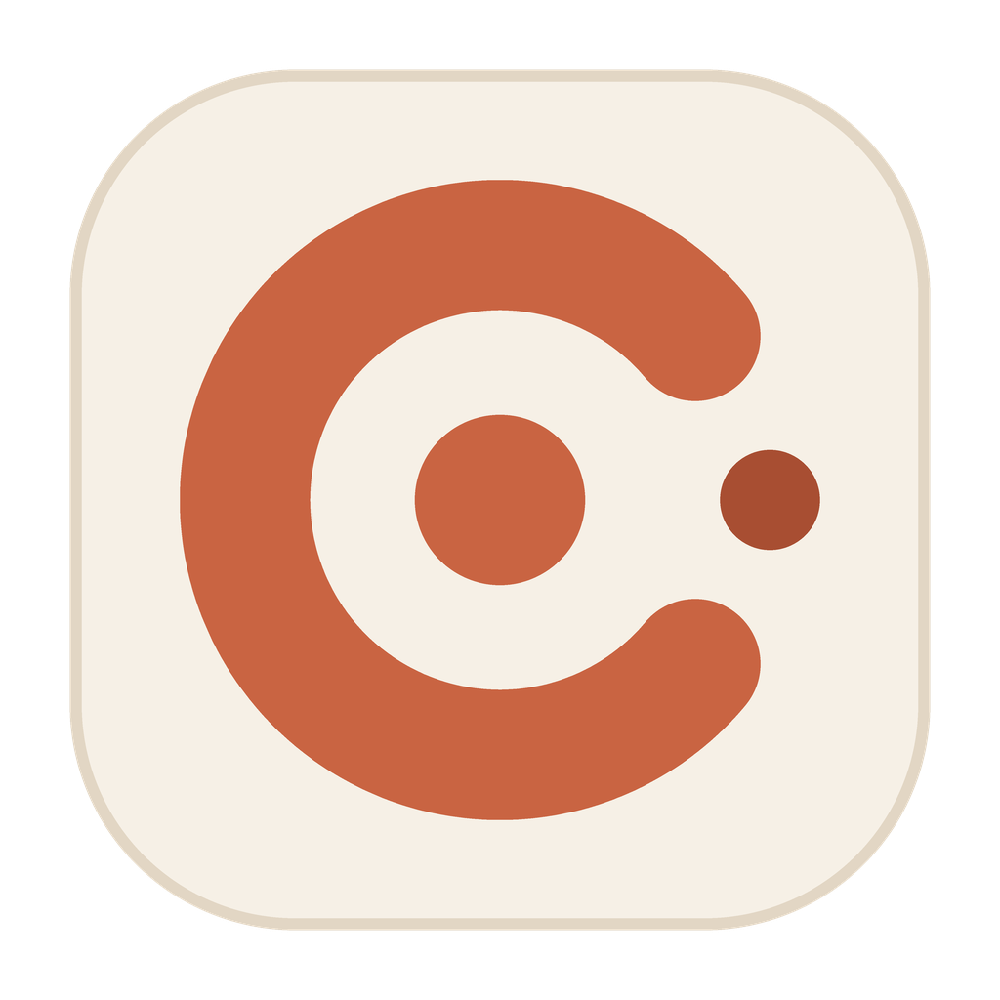

<div align="center">



# CMCP

### Let Claude on your cloud PC use this computer's files, commands and desktop

**Manage every cloud PC from one card-based desktop app, with independent connections, automatic recovery and easy sign-in.**

[](https://github.com/isAlexYoung/cmcp/releases)
[](https://github.com/isAlexYoung/cmcp/releases)
[](../LICENSE)
[](https://github.com/isAlexYoung/cmcp/releases/latest)

English | [中文](README_ZH.md) | [Changelog](https://github.com/isAlexYoung/cmcp/releases)

**[Download](#download) · [Quick Start](#quick-start) · [Features](#features) · [FAQ](#faq) · [License](#license)**

</div>

## Download

Get the latest version from [Releases](https://github.com/isAlexYoung/cmcp/releases/latest). Each package has a matching `.sha256` file.

| Platform | Package |
|---|---|
| Windows x64, guided installer (recommended) | `CMCP-<version>-windows-x64-setup.exe` |
| Windows x64, portable | `CMCP-<version>-windows-x64.zip` |
| macOS, Apple silicon | `CMCP-<version>-macos-arm64.dmg` |
| macOS, Intel | `CMCP-<version>-macos-x64.dmg` |

The macOS `.zip` files with the same names are for in-app updates. To install, download the `.dmg`.

## Quick Start

You need a cloud PC that is reachable at an HTTPS address and has Claude installed.

**Windows**

1. Run the installer and choose the install folder, shortcuts and whether to start at sign-in. It does not need administrator rights. The installer is not code-signed yet, so if Windows says it protected your PC, click **More info → Run anyway**. For the portable version, extract the whole zip to a folder and run `CMCP.exe`.
2. Open CMCP.
3. Click **Add device** and enter its address.
4. Start the connection and sign in to the cloud PC when asked.
5. After adding a new cloud PC, fully quit and reopen Claude on it.

Claude on the cloud PC can now use the tools on this computer.

**macOS**

1. Open the `.dmg` and drag `CMCP.app` to the Applications folder.
2. Open CMCP from Applications, then follow steps 3 to 5 above.

The app is ad-hoc signed rather than notarized, so macOS blocks it the first time you open it. Allow it once, depending on your macOS version:

- **macOS 15 and later**: click **Done** in the message, open **System Settings → Privacy & Security**, find CMCP near the bottom of the page, click **Open Anyway** and confirm.
- **macOS 13 and 14**: in Applications, Control-click CMCP, choose **Open**, then click **Open** in the message.
- **If macOS says the app is damaged**: this comes from the download quarantine flag. After checking the package against its `.sha256` file, run this in Terminal and open CMCP again:

```bash
xattr -dr com.apple.quarantine /Applications/CMCP.app
```

## Features

- **Independent connections**: start and stop each cloud PC on its own.
- **Card-based interface**: custom names and icons, drag to reorder, collapsible details.
- **Connection recovery**: reconnection, request waiting, result lookup and de-duplication after a dropped connection.
- **Easy sign-in**: share a browser sign-in, or save the password encrypted and sign in automatically.
- **SSH sign-in**: open your chosen terminal connected to a VPS with one click, using a password or a key. A device can have SSH, shared web sign-in or both. Opening the terminal first starts a background SSH channel for that device, which carries the MCP connection; the terminal you see is a separate SSH session.
- **Close on disconnect**: Settings → Connections picks the browser for shared web pages and the terminal for SSH, each shown with its own app icon. Disconnecting a device can also close its web page (with Edge, Chrome or Firefox, which then open it in a separate window with its own sign-in) and its terminal window. Both are off by default.
- **Personalization**: light and dark themes, English and Simplified Chinese.
- **Desktop integration**: system tray (menu bar on macOS), start at login, desktop shortcut and in-app updates.

## Control local Blender from Claude on a VPS

Install and enable the [MCP for Blender add-on](https://github.com/ahujasid/mcp-for-blender) on this computer, open Blender and start the add-on server in its sidebar. CMCP connects to `127.0.0.1:9876` by default. If the add-on uses a different port, pass it in the Blender tools' `port` argument.

Since 4.20 the Blender tools are off by default: turn on Settings → Tools → Blender (CMCP also offers this once when it finds Blender). Reconnect CMCP and restart Claude on the VPS to discover the `blender_*` tools. They inspect the live scene and objects, execute Blender Python and return viewport images. Windows and Mac share the adapter. WebDesktop, CloudCLI and SSH terminals use their existing MCP connections. No public Blender port or separate `uvx` server is needed.

Example: “Use CMCP to check my local Blender connection, inspect the current scene, create a red cube and show a viewport screenshot. Do not overwrite existing files.”

`blender_execute_code` immediately returns a job ID. Poll `blender_job_status` on the same MCP connector before continuing. Script deadlines default to 120 seconds and can be changed with `timeout_ms`, up to 10 minutes. A timeout or dropped connection does not cancel submitted Blender code. Edits are never automatically retried: inspect the scene first. Job records last only for the current CMCP session; exiting CMCP does not forcibly cancel submitted Blender code.

This adapter speaks the add-on's local protocol directly; it does not import every tool from the third-party MCP server. Asset service search, online generation and that server's safe mode are not included. When Blender is closed, only Blender tools report it unavailable; other MCP tools remain usable.

## Local MCP tools and the tool market

Settings → Tools switches CMCP's built-in tool groups on or off for this computer: files, commands, background tasks, toolchains, desktop and Blender. Blender is off by default.

CMCP can also run other MCP servers on this computer and pass their tools to Claude on the VPS:

- **Market** (Settings → Market): reviewed presets such as Blender, Playwright, Chrome DevTools, memory and fetch. Each preset is pinned to one version and holds only a configuration and a link to the project. On first start, `npx` or `uvx` downloads it from the official registry. Installed tools start off. An update to a newer version is shown and applied only after you confirm it.
- **Paste a configuration**: Settings → Tools → Add accepts the Claude Desktop `mcpServers` snippet from a server's README.
- **Write your own**: every tool is a folder in `mcp-tools` (next to `user` on Windows, `~/Library/Application Support/CMCP/mcp-tools` on the Mac) with a `cmcp-tool.json`. `AGENT.md` in that folder describes the format for people and coding agents, and how to test a tool with one command.

Claude sees these tools as `<folder>__<tool>`, for example `blender_mcp__get_scene_info`. CMCP uses only the Node.js, uv, Python or Docker already installed and tells you what is missing. Keys and tokens are kept in the system keychain or Windows encryption, never in the folder. Updating or uninstalling CMCP keeps `mcp-tools`.

**Contributing a preset**: add `app/mcp-presets/<id>.json` with a pinned package version and open a pull request. The rules and the check that CI runs are in `app/mcp-tools-template/AGENT.md` (section 8).

## FAQ

**CMCP says the portable package is incomplete. What should I do?**

Some files were not extracted. Extract the whole zip again to a new folder and run `CMCP.exe` from there.

**Claude on the cloud PC does not show the tools.**

Fully quit and reopen Claude on the cloud PC. A newly added configuration is only loaded when Claude starts.

**What happens when I close the window?**

It depends on **Settings → General → Minimize to tray on close** (**Minimize to menu bar on close** on macOS). When on, connected devices stay connected. When off, closing the window exits and disconnects every cloud PC.

**How do I update?**

Open **Settings → About → Check for updates**. CMCP downloads and verifies the update for you. On macOS, if the new version fails to start, CMCP returns to the previous version automatically. Updating needs permission to change the folder CMCP is in, so update from an administrator account when it is in Applications. Because the app is ad-hoc signed, macOS may ask you to grant permissions such as Accessibility again after an update.

**How do I uninstall?**

On Windows, open **Settings → About → Uninstall CMCP**. If you used the guided installer, you can also uninstall from Installed apps in Windows Settings. It disconnects everything, removes the Claude configuration from cloud PCs where it can, and deletes saved addresses, passwords and settings. The installed version also removes its program files and shortcuts. For the portable version, delete the program folder and desktop shortcut yourself afterwards.

On macOS, open **Settings → About → Uninstall CMCP**. It also disconnects everything and removes the Claude configuration from cloud PCs where it can, then deletes the app, the data in `~/Library/Application Support/CMCP`, passwords saved in Keychain and the login item. It cannot remove the configuration from a cloud PC that is not connected and has no saved password, and it tells you how many were missed. If you already dragged the app to the Trash, run this command to delete the data, then delete the items named `CMCP Mac cloud password` in Keychain Access:

```bash
rm -rf ~/Library/Application\ Support/CMCP
```

**Where are the logs?**

Open **Settings → About → Log folder**. On Windows, errors are written to `user\error.log` in the program folder. On macOS, logs and settings are in `~/Library/Application Support/CMCP`.

**Is CMCP an Anthropic product?**

No. CMCP is an independent tool with no official affiliation with Anthropic.

## License

The code is released under the [MIT License](../LICENSE). Bundled third-party components keep their own licenses; see [third-party notices](../THIRD_PARTY_NOTICES.txt).

### App icon

The CMCP icon is original artwork created for this project. It is © 2026 CMCP, all rights reserved, and is **not** covered by the MIT License.

You may use it only to refer to CMCP and as part of unmodified CMCP packages. Without written permission, you may not use it commercially, modify it, or use it for another product or service. Forks and derivative products must replace it. See the [full notice](../THIRD_PARTY_NOTICES.txt).
